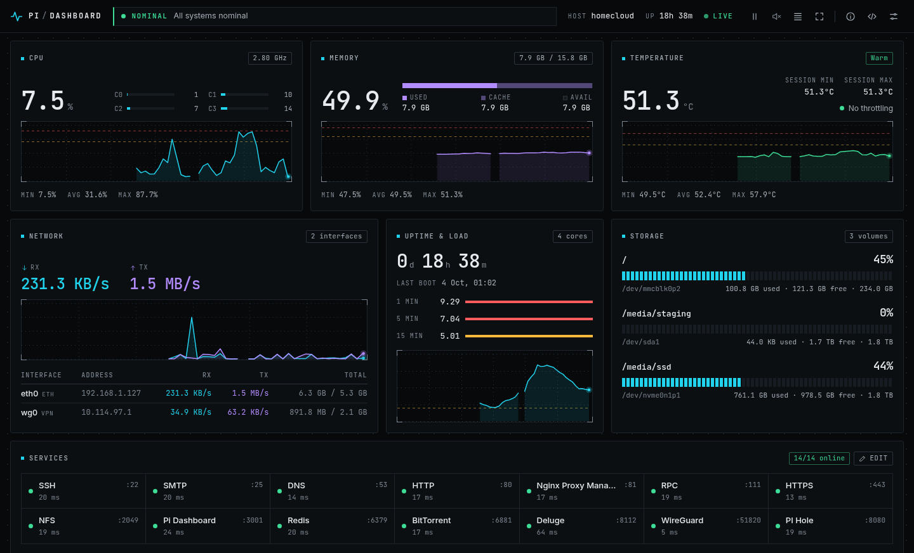

# Pi Dashboard

Real-time monitoring dashboard for a Raspberry Pi home server (or any Linux box): one
container, no database, a REST API and a built-in MCP server.




[](https://github.com/zepgram/pi-dashboard/actions/workflows/ci.yml)
[](https://hub.docker.com/r/usernamedigital/pi-dashboard)
[](https://hub.docker.com/r/usernamedigital/pi-dashboard)

## Features

- **Live metrics**: CPU (per core, frequency, overclock), memory, temperature, load,
  disks, network rates, top processes.
- **History**: the last hour and the last 24 hours of CPU, memory, temperature, load and
  network, kept in memory and carried across restarts.
- **Raspberry Pi specifics**: under-voltage and throttling status, session min/max
  temperature.
- **Docker**: every container with state, health, CPU and memory, without enabling the
  memory cgroup.
- **Service health**: HTTP, HTTPS, TCP, Redis, DNS and network-interface checks, with
  auto-discovery of what listens on the host.
- **WireGuard**: connected clients, last handshake, transfer.
- **Alerts**: configurable warning and critical thresholds, toast and optional sound.
- **REST API** protected by an API key, and an **MCP server** so an AI assistant can read
  the state of the machine.
- **Interface**: three densities (normal, compact, ultra for kiosks), five colour themes,
  keyboard shortcuts, installable on a phone. No external request: it works on a network
  without Internet access.
- Settings are stored server-side and shared by every device.

## Quick start (Docker)

The image is built for `linux/arm64` and `linux/amd64`.

```bash
mkdir -p pi-dashboard/data && cd pi-dashboard
curl -O https://raw.githubusercontent.com/zepgram/pi-dashboard/main/docker-compose.yml
docker compose up -d
```

The dashboard is at `http://your-pi-ip:3001`.

```yaml
services:
  pi-dashboard:
    image: usernamedigital/pi-dashboard:latest
    container_name: pi-dashboard
    restart: unless-stopped
    environment:
      - PORT=3001
      - SETTINGS_CONFIG=/app/data/settings.json
      - ADMIN_TOKEN=           # optional: protects configuration changes
      - CORS_ORIGINS=*
    volumes:
      - ./data:/app/data                               # settings, API key hash, history
      - /proc:/host/proc:ro                            # host metrics
      - /sys:/host/sys:ro
      - /:/host/root:ro                                # disks, OS release, pending updates
      - /var/run/docker.sock:/var/run/docker.sock:ro   # containers
      - /etc/wireguard:/etc/wireguard:ro               # WireGuard client names (optional)
    pid: host
    network_mode: host
    cap_add:
      - NET_ADMIN                                      # `wg show` (optional)
    # devices:
    #   - /dev/vcio:/dev/vcio                          # full throttling status (optional, Pi only)
```

| Setting | Why |
|---------|-----|
| `pid: host` | host processes and per-container memory |
| `network_mode: host` | host interfaces and service checks on `localhost` |
| `/proc`, `/sys`, `/` read-only | CPU, memory, temperature, cgroups, disk usage, OS information |
| `/var/run/docker.sock` | container list and state |
| `./data` | settings, API key hash and history survive restarts and upgrades |
| `/dev/vcio` | lets `vcgencmd` report frequency capping and thermal throttling; without it only live under-voltage is detected |

### Tags

| Tag | Content |
|-----|---------|
| `latest` | latest release |
| `2.0.0`, `2.0`, `2` | a release, its minor line, its major line |

### Upgrading from 1.x

Pull and restart: `docker compose pull && docker compose up -d`. The compose file, the
environment variables, `settings.json` and the API are unchanged. See
[CHANGELOG.md](CHANGELOG.md) for what is new and what was fixed.

### URL parameters

Handy for a kiosk or a wall display; they apply to that browser only.

| Parameter | Values |
|-----------|--------|
| `mode` | `normal`, `compact`, `ultra` |
| `theme` | `default`, `emerald`, `rose`, `amber`, `indigo` |
| `modal` | `settings`, `api`, `sysinfo`, `services`, `help`, `chart` |
| `chart`, `range` | with `modal=chart`: `cpu`, `memory`, `temperature`, `network`, `load` and `live`, `1h`, `24h` |

Example: `http://your-pi:3001/?mode=ultra&theme=emerald`. Press `?` in the dashboard for the
keyboard shortcuts.

## Running from source

Requires Node.js 22 or newer.

```bash
git clone https://github.com/zepgram/pi-dashboard.git
cd pi-dashboard
npm install
npm run dev        # API on :3001, Vite dev server on :5173
```

```bash
npm test           # unit and API tests
npm run build      # production frontend in dist/
npm start          # serves the API and dist/ on :3001
docker compose up -d --build   # build the image locally (uncomment `build: .`)
```

## Configuration

Everything lives in `settings.json` (`SETTINGS_CONFIG`). It is written by the interface and
can be edited by hand; changes are picked up without a restart.

```json
{
  "dashboard": {
    "theme": "default",
    "interval": 1,
    "sound": true,
    "thresholds": {
      "cpu": { "warning": 70, "critical": 90 },
      "memory": { "warning": 80, "critical": 95 },
      "temperature": { "warning": 65, "critical": 80 },
      "disk": { "warning": 80, "critical": 95 }
    }
  },
  "api": { "enabled": false, "keyHash": null },
  "wireguard": { "enabled": false, "interface": "wg0" },
  "services": [
    { "name": "Pi-hole", "port": 80, "path": "/admin/", "host": "localhost", "checkType": "http", "icon": "shield", "enabled": true }
  ]
}
```

| Service field | Description | Default |
|---------------|-------------|---------|
| `name` | display name | required |
| `port` | port to check | required |
| `checkType` | `http`, `https`, `tcp`, `redis`, `dns` or `interface` | inferred from the port |
| `path` | path requested by HTTP checks | `/` |
| `host` | host to check | `localhost` |
| `interface` | interface name for `interface` checks (`wg0`, `tun0`...) | from the port |
| `enabled` | checked and shown | `true` |

An HTTP check is `online` for any answer below 500 (a login page or a 403 means the service
is up). TLS certificates are not verified.

### Environment variables

| Variable | Description | Default |
|----------|-------------|---------|
| `PORT` | listening port | `3001` |
| `SETTINGS_CONFIG` | path of the settings file | `./settings.json` |
| `ADMIN_TOKEN` | when set, every configuration change needs the `X-Admin-Token` header | _(empty: no auth)_ |
| `CORS_ORIGINS` | allowed origins, comma-separated | `*` in the image |

Without `ADMIN_TOKEN`, anyone who can reach the port can change the settings. That is fine
on a home network; set a token, or put a reverse proxy with authentication in front, before
exposing the dashboard anywhere else.

## API

### Dashboard API

| Endpoint | Method | Description |
|----------|--------|-------------|
| `/api/stats` | GET | current metrics: CPU, memory, temperature, load, disks, containers, network, processes |
| `/api/history?range=1h\|24h` | GET | metric history (see below) |
| `/api/sysinfo` | GET | hardware and OS identity |
| `/api/services` | GET | health of the enabled services |
| `/api/services/config` | GET, PUT, POST | read, replace, add services |
| `/api/services/config/:index` | DELETE | remove a service |
| `/api/services/discover` | GET | services found listening on the host |
| `/api/settings` | GET, PUT | dashboard preferences |
| `/api/settings/api` | GET, PUT | external API switch and key |
| `/api/settings/wireguard` | GET, PUT | WireGuard monitoring |
| `/api/wireguard` | GET | WireGuard clients |
| `/api/health` | GET | liveness and version |

`PUT`, `POST` and `DELETE` need `X-Admin-Token` when `ADMIN_TOKEN` is set.

History format: `step` seconds between points (5 for `1h`, 60 for `24h`), point `i` is at
`from + i * step * 1000` (milliseconds), `null` where nothing was recorded.

```json
{
  "range": "1h",
  "step": 5,
  "from": 1791130290000,
  "to": 1791133885000,
  "series": { "cpu": [12.4, null], "memory": [], "temperature": [], "load": [], "rx": [], "tx": [] }
}
```

`cpu` and `memory` are percentages, `temperature` is in °C, `load` is the 1-minute load
average, `rx` and `tx` are bytes per second over the physical interfaces.

### External API (v1)

For other applications. Enable it and generate a key from the interface (API button).

| Endpoint | Description |
|----------|-------------|
| `GET /api/v1/system` | everything at once: metrics, hardware, services, WireGuard when enabled |
| `GET /api/v1/history?range=1h\|24h` | metric history |

```bash
curl -H "X-API-Key: YOUR_KEY" http://your-pi:3001/api/v1/system
curl -H "Authorization: Bearer YOUR_KEY" http://your-pi:3001/api/v1/system
curl "http://your-pi:3001/api/v1/system?key=YOUR_KEY"
```

Only a SHA-256 hash of the key is stored: the key is displayed once, when generated.

## MCP server

The dashboard speaks the [Model Context Protocol](https://modelcontextprotocol.io) on
`/mcp` (Streamable HTTP), so an assistant such as Claude can answer "is my Pi healthy?",
"what is using the CPU?" or "did the temperature spike last night?" from live data.

It is controlled by the same switch and the same key as the external API, and it is
**read-only**: no tool changes anything on the machine.

```bash
claude mcp add --transport http pi-dashboard http://your-pi:3001/mcp \
  --header "Authorization: Bearer YOUR_KEY"
```

For other clients:

```json
{
  "mcpServers": {
    "pi-dashboard": {
      "type": "http",
      "url": "http://your-pi:3001/mcp",
      "headers": { "Authorization": "Bearer YOUR_KEY" }
    }
  }
}
```

| Tool | Returns |
|------|---------|
| `get_system_overview` | CPU, memory, temperature and throttling, load, uptime, disks, network, container and service counts, alerts currently raised |
| `list_containers` | containers with state, health, CPU and memory (filter by state, sort) |
| `get_services_status` | status and latency of every configured health check |
| `get_top_processes` | processes using the most CPU right now |
| `get_history` | min, average, max and a downsampled series of one metric over 1 h or 24 h |
| `get_wireguard_clients` | WireGuard peers, when monitoring is enabled |
| `get_system_info` | board, CPU, memory, OS and kernel |

The endpoint is plain HTTP, like the dashboard. To reach it from outside your network, put
it behind a reverse proxy with TLS.

## Notes for Raspberry Pi

- Container memory is computed from the processes of each container, so it works on a
  stock Raspberry Pi OS where the memory cgroup controller is disabled. Container CPU is
  normalised: 100 % means every core is busy.
- Pending package updates are read with the host's `apt`, from the read-only host root.
- Top processes show the CPU share over the last sample (100 % = one core), like `top`.

## Project layout

```
server/            Express API
  collector/       sampling loop: host metrics, disks, Docker, processes
  history.js       1 h and 24 h ring buffers
  mcp.js           MCP tools
  checks.js        service health checks
  settings.js      settings store and validation
src/               frontend (vanilla JS modules, built with Vite)
test/              node:test suites
```

## License

MIT. See [LICENSE](LICENSE).
